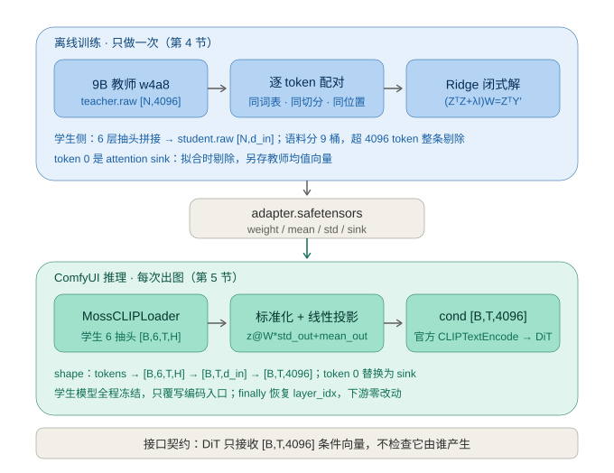

# 用小模型替换 9B 文本编码器：MOSS-Image Mini Encoder 原理拆解

> 面向 AI 学习者的源码导读型笔记   
> 上游项目：https://github.com/1cyberlangke1/moss-image-mini-encoder  
> 权重与适配器：https://huggingface.co/cyberlangke/moss-image-mini-encoder  
> 依据：本插件安装目录 `moss-image-mini-encoder/` 的源码与文档（上游 README 核对至 2026-11-03）  
> 整理日期：2026-11-07

本文所有 `src/...`、`docs/...` 路径均相对于本插件目录。表格与公式一律放在代码块中，避免不同 Markdown 渲染器的样式差异。

---

## 0. 这篇笔记能帮你学到什么

```text
学习目标                                      对应章节
理解文生图流水线里文本编码器的真实职责          1
学会「接口契约」视角：只要张量对，模型可替换    2
亲手推一遍 Ridge 回归闭式解并知道为何用它        3
看懂一次离线特征对齐工程的完整数据流            4
学习代理模式如何做到对下游代码零侵入            5
分清「小模型」与「低精度量化」两件不同的事      6
建立批判性认知：指标高不等于效果好              7
设计自己的消融实验去复现与证伪                  8
```

预备知识：Python 基础、矩阵乘法、知道「神经网络的隐藏层输出是向量」。不要求读过扩散模型论文。不认识的术语先查第 10 节术语表。

---


## 1. 背景：文本编码器在文生图里到底干什么

一条典型的文生图流水线：

```text
提示词文本
  -> Tokenizer            文本切成 token id 序列
  -> Text Encoder (TE)    每个 token 变成一个高维向量
  -> 条件张量 cond        [B, T, D]，本项目 D = 4096
  -> Diffusion Transformer (DiT)  通过 Cross-Attention 读 cond
  -> VAE 解码             潜变量变成像素
```

关键点有两个：

1. **TE 不生成任何文字**。它只做一次前向传播，把文本「压」成一组连续向量，之后全程冻结、不参与采样。这与聊天模型逐 token 生成完全不同。
2. **DiT 只看见 cond 这个张量**。它没有、也不需要任何「这是哪个模型算出来的」的标记。只要形状是 `[B, T, 4096]`、数值落在它训练时见过的分布里，它就照常工作。

原版 MOSS-Image 用的是 Qwen3.5-9B 的最后一层隐藏状态作为 cond（`src/moss_small_encoder/encode/encoder.py:3-4`）。9B 参数即便量化成 w4a8 也有约 7.3 GB，加载慢、占显存，在 8 GB 消费级显卡上会和 DiT 抢地方（`docs/models.md:38-48`）。

减负通常有三条路：

```text
思路                    做法                              代价
权重量化                把 bf16 权重压成 int8 / w4a8        精度损失，仍需加载全模型
知识蒸馏                训练一个小模型去模仿大模型输出        需要反向传播与大量算力
特征空间对齐（本项目）   小模型 + 一层学出来的线性翻译器      只能传递小模型已有的语义
缓存 / 预计算           相同提示词复用 cond                 只解决重复提示，不解决首次
```

本项目走第三条，并叠加第一条。理解「为什么第三条可行」是全文的核心。

---

## 2. 关键洞察：接口契约与三个前提

### 2.1 一个有用的类比

把 DiT 想成一台只认「4096 维插头」的设备。9B 是原装电源，0.8B 是另一个输出电压不同的电源。我们不去改设备，也不去改造电源内部，而是加一个**转换头**：把 0.8B 的输出电压映射到原装电源的规格上。这个转换头就是适配器，学名「线性投影层」。

因为 DiT 的参数在整件事里**一个字节都没动**，所以这既不是微调扩散模型，也不是重新训练文生图模型。

### 2.2 前提一：同系列、同词表，才能逐 token 对齐

如果学生模型对同一句话切出的 token 数量或位置与教师不同，那么「第 3 个 token 对应第 3 个 token」就不成立，必须引入注意力或序列对齐，问题会复杂得多。

Qwen3.5 全系列（0.8B / 2B / 4B / 9B）共享同一份词表与分词逻辑（`README.md:121`、`docs/models.md:63`）。更关键的是 MOSS 不是直接编码用户原文，而是先套一个固定的 chat 模板再分词：

```text
<|im_start|>user
{text}<|im_end|>
<|im_start|>assistant
<think>
```

模板字面量与 4096 token 上限在 `src/moss_small_encoder/tokenizer.py:20-23`，训练端必须与推理端逐字一致，否则训练时的 token 位置在推理时对不上。这是「训推一致性」的一个具体例子，工程上很容易踩坑。

于是同一条提示词在 9B 和 0.8B 里，token 数量、位置、切分完全相同。映射可以退化成**每个 token 独立**的向量变换：

```text
对每个位置 t：  cond[t] = f( h_student[t] )
f 与 t 无关，也不看邻居 token
```

### 2.3 前提二：TE 冻结，只提供「语义方向」

条件向量的作用是给扩散过程一个引导方向，而不是让语言模型展示知识或推理。作者据此假设：即使小模型的语义空间更粗糙，只要能通过线性变换把它摆到教师空间的大致位置上，DiT 就能继续工作。这个假设在常见描述性提示词上成立，在专名/世界知识上会失效（见第 7 节）。

### 2.4 前提三：输出维度是硬约束

DiT 的 Cross-Attention 权重矩阵形状写死了 4096 维输入，所以投影层输出必须是 4096。这也是 README 强调「专用于 MOSS-Image，不适用于其他扩散模型」的原因（`README.md:130`）。

---

## 3. 数学核心：为什么是一层线性 + Ridge 闭式解

### 3.1 问题形式化

离线准备好逐行对齐的两份特征：

```text
X : [N, d_in]    学生模型特征（N 是所有训练提示词的 token 总数）
Y : [N, 4096]    9B 教师模型特征，第 i 行与 X 的第 i 行是同一个 token
```

目标是找一个矩阵 `W`，让 `XW` 尽量接近 `Y`。注意这里**没有神经网络、没有反向传播、没有优化器**——这是一个纯粹的线性回归问题。

### 3.2 为什么先标准化

语言模型隐藏状态在不同通道上的数值方差差异极大，有些通道是「大常数 + 小波动」，有些通道几乎恒为零。直接对原始 `X` 求最小二乘，`XᵀX` 的条件数会很大，解对小扰动敏感，数值上也不稳定。

所以先在标准化空间求解：

```text
z = (x - mean_in) / std_in         对每个输入通道
y' = (y - mean_out) / std_out      对每个输出通道
求 W 使 z @ W ≈ y'
```

推理时再反标准化回教师空间。`mean/std` 这四个向量与 `W` 一起存进适配器文件，训练与推理必须用同一组统计量（`src/moss_small_encoder/train/ridge.py:141-174`、`src/comfyui_node/apply.py:75-76`）。

### 3.3 推导闭式解

带 L2 正则的最小二乘目标（Frobenius 范数）：

```text
L(W) = || Z W - Y' ||_F^2 + λ || W ||_F^2
```

对 W 求导并令其为零：

```text
∂L/∂W = 2 Zᵀ(Z W - Y') + 2 λ W = 0
      => (ZᵀZ + λ I) W = ZᵀY'
      => W = (ZᵀZ + λ I)^(-1) ZᵀY'
```

三点值得记住：

- `ZᵀZ` 是 `d_in × d_in` 的Gram 矩阵，与样本数 N 无关。因此可以用流式累加：读一块特征算一块 `XᵀX`、`XᵀY` 就丢掉，任何时刻显存里只有一块数据（`src/moss_small_encoder/train/ridge.py:272-384`）。这是处理几百万 token 特征库的标准手法。
- `λI` 让矩阵从「可能奇异」变成对称正定，既防过拟合也让求逆稳定。实现里用 Cholesky 分解（比通用求解省一半运算）加 fp64 残差迭代精化（`ridge.py:454-504`）。
- **闭式解没有随机性**：同一份特征、同一个 λ，永远得到同一个 W。不需要调学习率、不需要早停、可完整复现。λ 本身在验证集上做对数网格扫描，按整体余弦相似度选最优（`src/moss_small_encoder/train/run.py:46` 定义了 12 个候选值）。

docs/pipeline.md:109 把它写成 `(XᵀX + λI)W = XᵀY`，与上式是同一件事，只是省略了标准化记号。

### 3.4 推理侧的完整公式

`src/comfyui_node/apply.py:75-76` 两行代码就是这个公式：

```text
z    = (h - mean_in) / std_in                    h: [B, T, d_in]
proj = (z @ W) * std_out + mean_out              W: [d_in, 4096]
cond[:, 0, :] = sink                             首 token 特殊处理，见 4.4
```

**常见错误提醒**：如果推理时忘了标准化，或者用了训练时不同的 mean/std，W 就完全失效。这也是为什么作者把四个统计量打包进同一个 safetensors，而不是只存 W。

### 3.5 为什么不用 MLP 或微调

- 线性映射参数量极小，可以直接从适配器体积反推（见 4.5），推理只多一次矩阵乘，几乎不耗时。
- 训练数据是「教师特征 → 学生特征」的配对，用闭式解一次算完，不需要 GPU 上跑 epoch。
- 作者明确说避免了迭代训练的梯度震荡与过拟合风险（`README.md:123`）。
- 代价也明显：线性变换只能做旋转、缩放、通道混合，**无法创造小模型本来没有的信息**（第 7 节）。

---

## 4. 工程实现：适配器是怎么造出来的

### 4.1 训练语料要覆盖真实分布

`docs/pipeline.md:49-68` 把语料分成 9 个桶：MOSS 专有的 layout JSON、英文 tag 序列、英文/中文连续描述、中文标签流、负面提示词、官方示例、LLM 合成的硬 case。

意图很直接：投影层只在见过的 token 分布上被拟合过。如果训练时全是中文散文，推理时丢进来一段 Danbooru 标签 JSON，映射就可能偏。这属于**分布外泛化（OOD）**问题，也是 `docs/benchmark.md` 里专门补做「SD tag vs 中文自然语言」对照的原因。

清洗规则也值得学：超过 4096 token 的样本整条剔除而不是中间截断，避免半句语义破坏；抽样基于 `source_id` 哈希，保证数据集可复现。

### 4.2 两阶段离线抽特征

9B 教师和学生模型同时上单卡会爆显存，所以拆成两遍顺序执行（`docs/pipeline.md:71-77`）：

```text
遍次      装载                 产物                     说明
教师遍    9B w4a8 量化权重     teacher.raw [N, 4096]   取最后一层隐藏状态，不含 lm_head
学生遍    0.8B / 2B / 4B      student.raw [N, d_in]   取 6 个抽头拼接
```

特征以 fp16 二进制顺序落盘，配合记录 token 偏移量支持断点续跑（`src/moss_small_encoder/encode/run.py:500-656`）。这是典型的「用磁盘换显存」策略：几百万 token × 4096 维 × 2 字节是几十 GB 级数据，不可能常驻内存，读取时用 mmap 分块喂给 GPU。

补充一个容易忽略的事实：教师用的是 **Comfy-Org 发布的 w4a8 GPTQ 量化 9B**（`encode/run.py:33-34`、`docs/models.md:38-48`），不是 bf16 原版。所以对齐目标是「量化教师」的特征空间，不是原始 9B。

### 4.3 为什么要取 6 层抽头

学生模型只取最后一层会丢掉浅层的词法/句法信息，而小模型容量有限，深层特征未必足够。作者固定取第 2 / 4 / 8 / 12 / 16 层与最后一层，按序拼接（`README.md:16`、`docs/comfyui-node.md:55-56`）：

```text
d_in = 6 × hidden_size
```

`src/moss_small_encoder/encode/base.py:37-46` 用 `output_hidden_states=True` 一次前向拿到全部层，避免为每层重复跑一遍模型。

这里有个工程坑：训练端用 transformers 的 `hidden_states` 下标（0 是 embedding，-1 是过 final norm），ComfyUI 的 `layer_idx` 语义不同（j 是第 j 个 block 的输入）。`src/comfyui_node/adapter.py:48-66` 的 `to_comfy_taps()` 专门做换算：`-1 → num_layers`。这类「两套框架口径不一致」的适配，在真实项目里非常常见。

### 4.4 attention sink：一个必须单独处理的异常 token

Transformer 里第 0 个 token 往往承担「attention sink」角色：它的向量范数极大、方向在不同提示词间几乎恒定，主要吸收多余的注意力权重，本身不携带提示词语义。

如果把它混进回归拟合，它会以极端杠杆点 dominating 最小二乘解。作者的处理方式（`encode/run.py:515-516, 655`、`ridge.py:9`、`:337-370`）：

```text
训练时  每条 prompt 丢弃第 0 个 token，不参与 XᵀX / XᵀY 累加
        同时单独累加教师 token 0 的向量，求全局均值存为 sink
推理时  不对 token 0 做投影，直接替换为 sink 向量
```

`src/comfyui_node/apply.py:71-79` 里 `head` 就是这行逻辑。sink 是可选张量，老适配器没有就跳过替换（`adapter.py:25-26`），这是很好的向后兼容设计。

### 4.5 从文件体积反推「确实只有一层线性」

适配器是一个 safetensors，包含 6 个张量（`src/moss_small_encoder/train/export.py:33-46`）：

```text
键名              类型      形状            含义
weight            float16   [d_in, 4096]   标准化空间下的投影矩阵
mean_in / std_in  float32   [d_in]         学生侧标准化统计量
mean_out/std_out  float32   [4096]         教师侧反标准化统计量
sink              float32   [4096]         教师 token 0 均值（可选）
metadata          -         -              format / taps / alpha / val_cosine 等
```

规格对照（hidden 由「6 抽头维度 ÷ 6」反推，与 `docs/comfyui-node.md:56` 一致）：

```text
学生   hidden    d_in = 6×hidden   weight 体积          README 适配器体积
0.8B   1024      6144              6144×4096×2 = 48.0 MiB    48.1 MB
2B     2048      12288             96.0 MiB                   96.1 MB
4B     2560      15360             120.0 MiB                  120.1 MB
```

`d_in × 4096 × 2 bytes` 精确对上官方标称体积，说明文件里没有第二层权重、没有偏置、没有 MLP。学会用「参数量/文件体积」反推模型结构，是读开源项目很实用的一招。

---

## 5. 推理侧：如何在 ComfyUI 里做到零侵入

### 5.1 节点长什么样

```text
MossCLIPLoader(clip_name, type="moss_image", adapter)
    -> CLIP（标准对象）
    -> CLIPTextEncode（官方节点，不用改）
    -> KSampler / DiT
```

`MossCLIPLoader` 本身几乎不做事：先调官方 `CLIPLoader().load_clip(...)` 得到真正的 CLIP 对象，再用 `_ProjectedClip` 包一层返回（`src/comfyui_node/loader.py:67-74`）。`adapter` 选 `none` 时直接返回原生 CLIP，等价于官方行为——这个开关同时也是很好的实验对照组。

### 5.2 代理模式（Proxy Pattern）

`src/comfyui_node/apply.py:31-141` 的 `_ProjectedClip` 是教科书式的代理对象：

```text
手法                          代码位置              目的
__getattr__ 转发给内部 clip    apply.py:43-44      下游访问任何属性都像原对象
覆写 encode_from_tokens       apply.py:82-109     兼容返回 cond / tuple / dict 三种形态
覆写 ..._scheduled            apply.py:111-136    CLIPTextEncode 实际走这条
临时改 layer_idx + finally    apply.py:93-100     取多层输出后立刻恢复，不污染其它流程
clone() 重新包装              apply.py:138-140    深拷贝后仍带投影
```

`finally` 里恢复 `layer_idx` 这一细节值得学习：它保证即使编码抛异常，全局模型状态也不会被改坏。

### 5.3 一次编码的完整 shape 变换

```text
tokens                          [B, T]
学生模型（layer_idx = 6 个抽头）  -> [B, taps=6, T, H]
permute + reshape                -> [B, T, 6H] = [B, T, d_in]
.float() + 标准化                 -> z
z @ W  [6H, 4096]                -> [B, T, 4096]
* std_out + mean_out             -> [B, T, 4096]
token 0 替换为 sink              -> [B, T, 4096]
.to(cond.dtype)                  -> 交回 CLIPTextEncode
```

对应 `apply.py:59`、`:75-80`。维度校验在 `:53-67`：如果适配器要求的 `d_in` 与当前抽头拼接宽度不符，直接报清晰错误——这就是「不同尺寸学生模型不可混用适配器」的报错来源。

节点还会注册 `models/moss_encoder_adapters/` 目录（`src/comfyui_node/encode.py:12-25`），并对适配器张量按「文件 mtime + 设备」做缓存（`adapter.py:69-172`），避免每次执行节点都重新读盘和搬运 48 MB 权重。

---

## 6. 「低精度」到底指什么：两层压缩的澄清

最常见的误解是把「换成低精度 TE」理解成「把 9B 量化了」。实际上这是两件独立的事：

```text
层级        手段                         从              到                 谁负责补偿
参数量      换同系列更小的语言模型       9B              0.8B / 2B / 4B     线性投影补维度与空间
权重位宽    comfy_kitchen 权重量化       bf16            int8 / w4a8         专属适配器补特征漂移
```

第二层由 `src/scripts/quantize_encoder.py` 完成：纯权重量化（RTN + Hadamard 旋转），**不需要校准数据**；w4a8 用码本 + 分组 fp8 scale（`asym_w4a8_int8`, group_size 16），int8 用逐通道 scale + Hadamard（`int8_tensorwise`）。按 Qwen 官方 FP8 的排除清单跳过卷积核、门控投影、词表、视觉塔（`:33-41`）。输出格式与 ComfyUI 生产路径同一份实现，所以官方 `CLIPLoader` 能直接加载（`:124-140`）。

量化会轻微改变隐藏状态分布，因此**每个量化档要单独训一份适配器**。README 的警告很精确：同尺寸不同量化格式的维度相同、可以加载，但交叉使用会特征漂移，建议搭配对应量化版本训练的专属适配器（`README.md:28`）。

规格与显存（`README.md:18-26`）：

```text
学生    格式     权重体积    适配器   学生+适配器显存估算
0.8B    bf16     1.63 GB     48.1 MB  ~1.80 GB
0.8B    int8     1.15 GB     48.1 MB  ~1.25 GB
0.8B    w4a8     0.94 GB     48.1 MB  ~1.02 GB   （显存最小）
2B      bf16     4.24 GB     96.1 MB  ~4.50 GB
2B      int8     2.90 GB     96.1 MB  ~3.10 GB
2B      w4a8     2.32 GB     96.1 MB  ~2.50 GB   （均衡首选）
4B      w4a8     3.75 GB     120.1 MB ~3.87 GB   （效果最接近 9B）
```

bf16 档用 Qwen 官方原版权重，量化档用 HF 仓库 `weights/` 里的量化文件，适配器放 `ComfyUI/models/moss_encoder_adapters/`（`README.md:88-93`）。

---

## 7. 效果、局限与批判性思考

### 7.1 实测口径与结果

`docs/benchmark.md:5-17` 的测试条件：RTX 4060 Laptop 8 GB / 32 GB RAM、DiT int8、4 步 LoRA、cfg 1.0、seed 42、1024×1024。以下数字只在这个口径下成立，换硬件或采样参数不能直接套用。

```text
档位        只给角色名「蔚蓝档案的鬼方カヨコ」      cos vs 9B   端到端热态
9B w4a8     白发黑挑染、红瞳、双角、光环，角色正确   1.0000       33.1 s
4B w4a8     有角与光环，但蓝瞳、无挑染，认错人       0.8638       23.6 s
2B w4a8     白发蓝瞳普通少女，没有角也没有光环       0.8372       20.4 s
0.8B bf16   金发蓝眼，未识别该专名                   0.8149       20.3 s
```

另一条测试「蜜雪冰城的雪王站在店门口」：9B 全对，4B 少了身上竖排字，2B 把雪人画成雪堆，0.8B 把招牌写成「𠳨雪冰城」、雪王画成穿龙袍的老者。

### 7.2 最重要的一课：指标高不等于效果好

余弦相似度 0.86 听起来「对齐得不错」，但出图认错了人。README 自己给出判词：「只给名称时，小模型会认错人甚至完全认不出——判据是出图；余弦只说明条件向量偏了」（`README.md:66`）。

原因值得想清楚：投影层优化的是**逐 token 特征向量的整体余弦**，而最终任务指标是**生成图像是否还原了用户意图**。两者之间隔着 DiT 的非线性采样，且专名/世界知识这类信息恰恰编码在向量里很小但很关键的方向上。优化代理指标（surrogate metric）与真实目标脱节，是机器学习里反复出现的陷阱。

### 7.3 能力天花板与工程边界

- **线性映射不能创造知识**：它只能重新排列小模型已有的语义空间。小模型没记住「鬼方カヨコ」长什么样，再怎么旋转向量也变不出来。补上外观描述后各档表现明显改善，正说明瓶颈在知识而非对齐。
- **只服务 MOSS-Image**：输出维固定 4096、6 抽头写死，换基础模型需重新适配层结构（`README.md:129-131`）。
- **长度边界**：训练语料最长约 3200 token，推理上限 4096；更长提示词属于分布外。
- **不可跨尺寸混用适配器**：`d_in` 不同会直接报维度错。
- **适配器的目标是量化教师**：见 4.2。

### 7.4 事实、推断与未验证事项

```text
类别      内容                                                       依据
代码事实  投影公式、6 抽头、Ridge 闭式解、sink 替换、代理节点         本文各节所引源码行号
文档事实  显存规格、cos 与耗时数据                                    README / benchmark.md
推断      学生 hidden = 1024/2048/2560                               由 6 抽头维度反推，与文档一致
未验证    量化 kernel 在非 CUDA 后端（如 Intel XPU）的可用性          训练端硬编码 cuda（encode/run.py:993）
未验证    本地示例工作流能否直接运行                                   见 8.3
```

---

## 8. 自己动手：复现、验证与避坑

### 8.1 最小实验：单变量对照

先建立基准，再每次只改一个变量：

```text
步骤 1  官方 CLIPLoader + 9B（adapter=none）     记录出图与耗时，作为 ground truth
步骤 2  MossCLIPLoader + 学生 + adapter=none     确认不投影时行为与官方一致
步骤 3  同上，adapter 选对应档位                 观察投影带来的变化
步骤 4  换同一尺寸的另一个量化档                 观察特征漂移
步骤 5  故意错配适配器（同尺寸不同量化）         复现 README 说的「轻微漂移」
```

想更严谨可以用 2×2 析因设计：`学生尺寸 × adapter 开关`，或 `量化格式 × adapter 专属/错配`，每个组合固定 seed、固定提示词、固定分辨率，只比较出图与耗时。这比「换一个看看效果」可靠得多。

### 8.2 可以自己写的检查脚本

- 读适配器的 safetensors，打印 `weight.shape`、`metadata`（含 `taps` / `alpha` / `val_cosine`），验证 4.5 节的体积推算。
- 用 `safetensors` 校验 `std_in` / `std_out` 全为正、`weight` 无 NaN/Inf（节点加载时就是这么校验的，`adapter.py:110-127`）。
- 同一提示词分别取 9B 与「学生+适配器」的 cond，算逐 token 余弦，自己复现 benchmark 里的数值。
- 把 cond 做 PCA 或降维可视化，看小模型的条件向量分布与教师差在哪。

### 8.3 本地这份安装目录的坑

`workflows/wf_08b_4step.json:82` 引用了 `MossEncoderCondEncode` 节点，但 `src/comfyui_node/__init__.py:10-11` 明确写着历史节点（`MossEncoderCondEncode` / `MossCondLoader` / `MossCondDumper` / `ApplyProjection`）**不再注册**，当前只注册 `MossCLIPLoader`。直接打开这个示例工作流会缺节点，需要按 `README.md:106-111` 改成 `MossCLIPLoader` + 官方 `CLIPTextEncode`。

### 8.4 建议的源码阅读顺序

```text
1  README.md                              先有全局图景
2  docs/pipeline.md                       逐 token 对齐原理与训练流水线
3  src/moss_small_encoder/tokenizer.py    训推一致性
4  src/moss_small_encoder/train/ridge.py  数学核心（重点看 prepare / solve）
5  src/moss_small_encoder/train/export.py 产物格式
6  src/comfyui_node/loader.py             入口
7  src/comfyui_node/apply.py              推理侧投影（重点看 _project）
8  src/comfyui_node/adapter.py            校验、tap 换算、缓存
9  docs/benchmark.md                      用批判眼光看结果
```

### 8.5 思考题

1. 如果换成一个**不共享词表**的学生模型（比如 Llama 系），逐 token 对齐还成立吗？需要额外引入什么机制？（提示：token 对齐 / 重采样 / 跨注意力）
2. 为什么 `λ` 要扫描而不能凭经验固定一个值？如果最优 λ 落在扫描网格的边界上，说明了什么？（提示：看 `train/run.py:44-46` 的注释）
3. 为什么用闭式解而不是梯度下降训练 W？如果特征库大到 `d_in²` 矩阵放不进显存，该怎么办？（提示：d_in=15360 时 `XᵀX` 是 fp64 约 1.9 GB）
4. attention sink 如果不剔除，会对最小二乘解产生什么影响？（提示：杠杆点、范数）
5. 余弦 0.86 但出图认错人，请设计一个比「整体余弦」更接近出图质量的验证指标。（提示：专名词元加权、下游出图人工/模型打分）
6. `adapter=none` 存在的意义是什么？如果项目去掉这个开关，会损失什么？（提示：对照组、回归测试、9B 直通）
7. 假设 DiT 换成只接受 2048 维条件的模型，这套适配器需要改哪些地方？哪些能复用？

---

## 9. 一句话总结

**接口不变 + 特征空间对齐**：DiT 只认 `[B, T, 4096]` 这个张量契约，于是可以用离线 Ridge 回归把冻结的小模型隐藏状态线性翻译成 9B 的条件空间，再在 ComfyUI 里用一层代理对象无侵入地接回去。它省的是显存与加载时间，代价是小模型本身缺失的知识——线性变换补不回来。

这类思路与 `ComfyUI-ClipProj`、`moss-image-smaller-encoder` 一脉相承（见 `README.md:149-152`），既不是知识蒸馏出新模型，也不是把 9B 压成低精度。

---

## 10. 术语表

```text
TE / Text Encoder     文本编码器，把提示词变成条件向量；推理时冻结
Tokenizer             分词器，把字符串切成 token id
Chat template         推理前给提示词套的固定对话模板，训推必须一致
Hidden state          隐藏状态，Transformer 每层对每个 token 输出的向量
逐 token (per-token)  映射对每个位置独立、与邻居无关
DiT                   Diffusion Transformer，扩散主干，通过 Cross-Attention 读条件
Cross-Attention       让图像特征去「查询」文本条件的注意力机制
cond                  条件张量，本项目形状 [B, T, 4096]
CLIP / CLIPTextEncode ComfyUI 里表示文本编码器及其编码节点的对象/接口
抽头 (tap)            取模型中间某层的隐藏状态；多抽头即拼接多层
attention sink        第 0 个 token 的异常大范数向量，方向近似恒定
标准化 / 条件数        减均值除方差以改善矩阵求解的数值稳定性
Gram 矩阵 XᵀX         特征相关矩阵，尺寸 [d_in, d_in]，与样本数无关
最小二乘 / Ridge       最小化 ||XW-Y||²，加 λ||W||² 正则即为 Ridge
闭式解                直接由公式算出最优解，无需迭代优化
Cholesky 分解         对称正定矩阵的专用求解法，约省一半运算
λ 网格扫描            在验证集上试多个正则强度挑最优
余弦相似度            衡量两个向量方向一致性，此处用于选 λ 与报告对齐度
相对 L2 误差          ||pred-target|| / ||target||
量化 int8 / w4a8       把权重从 16 位浮点压到 8 位整数 / 4 位权重+8 位激活
RTN                   Round-To-Nearest，最朴素的舍入量化
Hadamard 旋转          量化前做正交变换，把离群值摊平以减小量化误差
GPTQ / 码本            一类权重量化方法与查表式编码
fp16 / bf16 / fp32     浮点精度；训练统计量用 fp32，特征落盘用 fp16
代理模式 (Proxy)       包一层对象、覆写入口、其余属性转发给原对象
训推一致性            训练与推理的模板、统计量、维度口径必须完全相同
分布外泛化 (OOD)       模型在训练分布之外输入上的表现
消融实验 (ablation)    逐个去掉某组件，观察它对结果的贡献
```

---

## 11. 延伸阅读与出处

```text
上游仓库        https://github.com/1cyberlangke1/moss-image-mini-encoder
权重与适配器    https://huggingface.co/cyberlangke/moss-image-mini-encoder
MOSS-Image      https://github.com/OpenMOSS/MOSS-Image
Comfy-Org 权重  https://huggingface.co/Comfy-Org/MOSS-Image
投影层参考      https://github.com/nicolab28/ComfyUI-ClipProj
适配器命名参考  https://github.com/bakapotatolord/moss-image-smaller-encoder
Qwen3.5 系列    https://huggingface.co/Qwen/Qwen3.5-9B （及 0.8B / 2B / 4B）
```

项目内文档：`README.md`、`docs/pipeline.md`、`docs/comfyui-node.md`、`docs/models.md`、`docs/benchmark.md`、`docs/dataset.md`、`docs/scripts.md`。

许可证：项目代码与适配器权重遵循 Apache-2.0，第三方组件见 `NOTICE`。本笔记为学习整理，代码与数据版权归原作者。
